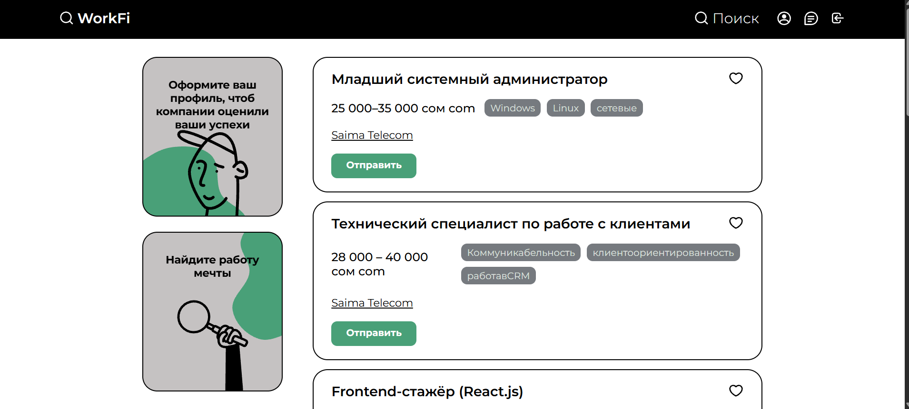

# 💼 WorkFi — Job Search Platform

**WorkFi** — веб-платформа для поиска работы и размещения вакансий, разработанная в рамках выпускного дипломного проекта.

Проект представляет собой платформу по поиску работы, функционально напоминающую HeadHunter. Она предназначена для взаимодействия соискателей и работодателей, предоставляя удобный интерфейс для поиска вакансий и работы с информацией о трудоустройстве.

Frontend-приложение разработано с использованием React 19, Redux Toolkit и React Router DOM. Для имитации Backend и хранения данных во время разработки используется JSON Server.

**WorkFi — мой дипломный проект, успешно представленный и защищённый в рамках выпускной квалификационной работы.**

---

## 📸 Screenshots



---

## ✨ Features

- 💼 **Job Listings** — просмотр доступных вакансий.
- 🔎 **Job Search** — поиск вакансий по интересующим параметрам.
- 👤 **User Authentication** — регистрация и авторизация пользователей.
- 📝 **Form Validation** — проверка пользовательских данных с помощью Formik и Yup.
- 📄 **User Profile** — работа с пользовательскими данными.
- 🔄 **State Management** — централизованное управление состоянием приложения через Redux Toolkit.
- 🧭 **Navigation** — маршрутизация между страницами с помощью React Router DOM.
- 🔗 **API Integration** — взаимодействие с серверной частью через Axios.
- 🖥️ **Mock Backend** — использование JSON Server для имитации REST API.
- 🎨 **Responsive UI** — удобный пользовательский интерфейс.

---

## 🛠 Tech Stack

| Technology | Purpose |
|---|---|
| React 19 | Разработка пользовательского интерфейса |
| JavaScript (ES6+) | Клиентская логика приложения |
| Redux Toolkit | Управление глобальным состоянием |
| React Redux | Интеграция Redux с React |
| React Router DOM 7 | Маршрутизация и навигация |
| Axios | HTTP-запросы и взаимодействие с API |
| Formik | Управление формами |
| Yup | Валидация пользовательских данных |
| JSON Server | Имитация Backend API |
| Sass (SCSS) | Стилизация интерфейса |
| React OTP Input | Ввод одноразовых кодов подтверждения |
| npm | Управление зависимостями |

---

## 🏗 Architecture & Development

Приложение построено на основе компонентной архитектуры React с использованием Redux Toolkit для централизованного управления состоянием.

Основные архитектурные решения:

- **Component-Based Architecture** — разделение приложения на независимые и переиспользуемые компоненты.
- **Redux Toolkit** — организация глобального состояния и логики обработки данных.
- **React Router DOM** — настройка маршрутов и навигации между страницами.
- **Axios** — организация HTTP-запросов и взаимодействия с API.
- **Formik & Yup** — обработка пользовательских форм и валидация данных.
- **JSON Server** — создание локального REST API для работы с данными.
- **SCSS** — организация стилей и оформление пользовательского интерфейса.

---

## 🧠 What I Learned

В процессе разработки дипломного проекта я получил практический опыт:

- Разработки полнофункциональных React-приложений.
- Построения архитектуры Frontend-приложения.
- Использования Redux Toolkit для управления состоянием.
- Создания Redux Slice и асинхронной логики работы с данными.
- Настройки маршрутизации с React Router DOM.
- Реализации форм регистрации и авторизации.
- Валидации данных с помощью Formik и Yup.
- Интеграции Frontend с REST API через Axios.
- Создания и настройки локального Backend с помощью JSON Server.
- Организации взаимодействия между пользовательским интерфейсом и серверными данными.
- Разработки интерфейса платформы для поиска работы.

---

## 💻 Installation & Setup

Для локального запуска проекта необходимо установить зависимости и отдельно запустить Frontend и JSON Server.

### 1. Clone the repository

```bash
git clone <REPOSITORY_URL>
```

### 2. Navigate to the project directory

```bash
cd WorkFi
```

### 3. Install dependencies

```bash
npm install
```

### 4. Start the Frontend

Откройте первый терминал и выполните:

```bash
npm run dev
```

Frontend-приложение будет доступно по адресу:

[http://localhost:5173](http://localhost:5173)

### 5. Start JSON Server

Откройте второй терминал в директории проекта:

```bash
npm run server
```

JSON Server запустит локальный API. Адрес сервера и порт определяются настройками скрипта в `package.json`.

**Important:** Для корректной работы приложения необходимо одновременно запустить Frontend и JSON Server.

---

## 🎓 Graduation Project

**WorkFi** — дипломный проект, разработанный и успешно защищённый в рамках выпускной квалификационной работы.

Проект демонстрирует практическое применение современных Frontend-технологий для создания платформы поиска работы и взаимодействия пользователей с вакансиями.

---

## 👨‍💻 About the Project

**Developer:** Дастан Алмазбеков

**Role:** Frontend Developer

**Project Name:** WorkFi

**Project Type:** Job Search Platform

**Project Status:** Successfully Defended

**Main Focus:** React 19, Redux Toolkit, React Router DOM, Axios, JSON Server

---

## 🔗 Live Demo

[WorkFi — Visit Website](<https://work-fi-chi.vercel.app/auth/login>)

---

⭐ Thanks for checking out my project!
